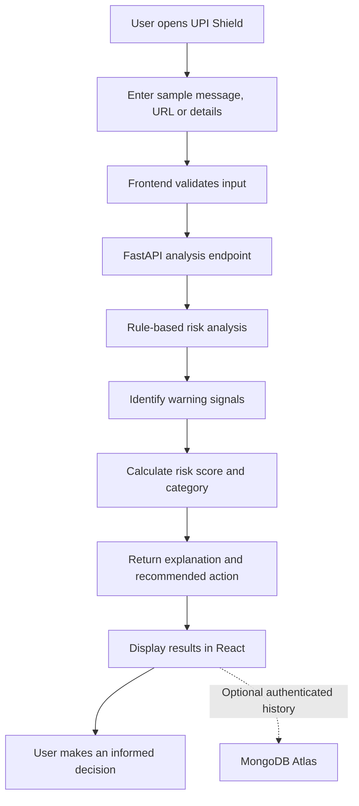
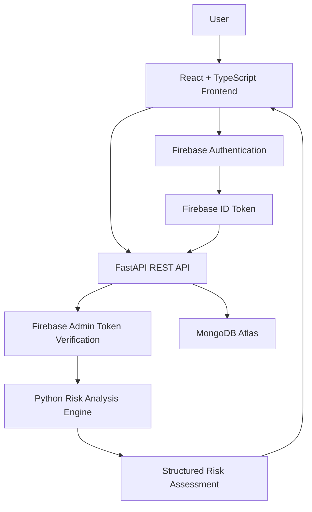

# 🛡️ UPI Shield
### Stop Fraud Before Payment

**An explainable, privacy-conscious fraud-risk screening platform that helps people recognize suspicious UPI payment requests, scam messages, and malicious links before they act.**

<p align="center">

  
  
  
  

</p>

<p align="center">
  <strong>Detect warning signs. Understand the risk. Make a safer decision.</strong>
</p>

---

## 📌 Table of Contents

- [Overview](#-overview)
- [The Problem](#-the-problem)
- [Our Solution](#-our-solution)
- [Key Features](#-key-features)
- [How It Works](#-how-it-works)
- [System Architecture](#-system-architecture)
- [Technology Stack](#-technology-stack)
- [Project Structure](#-project-structure)
- [Getting Started](#-getting-started)
- [Environment Configuration](#-environment-configuration)
- [API Reference](#-api-reference)
- [Demo Scenarios](#-demo-scenarios)
- [Security and Privacy](#-security-and-privacy)
- [Testing](#-testing)
- [Roadmap](#-roadmap)
- [Team and Contributions](#-team-and-contributions)
- [Disclaimer](#-disclaimer)

---

## 🚀 Overview

UPI Shield is a security-focused web application designed to help users identify common warning signs associated with fraudulent digital payment requests.

Digital payment scams frequently exploit trust, urgency, impersonation, fake rewards, suspicious links, and social engineering. Many victims are pressured into taking action before they have time to verify the request.

UPI Shield introduces a simple safety checkpoint between receiving a suspicious request and deciding what to do next.

Users can submit a sample message, inspect a suspicious link, or review recipient-related information. The application analyzes available indicators, produces an explainable risk assessment, and recommends practical safety actions.

### Our mission

> Make digital payment safety understandable, accessible, and actionable for everyone.

**Project type:** Cybersecurity · FinTech Safety · Fraud-Risk Awareness · Web Application

**Target audience:** UPI users, students, families, digital payment beginners, and people who want to make safer online payment decisions.

## 🔍 The Problem

UPI and other instant digital payment systems make transferring money convenient. However, scammers can exploit users through social engineering and deceptive payment instructions.

Common challenges include:

- **Fake rewards and refunds:** Messages claiming that users have won money or must complete a verification step to receive a refund.
- **PIN and OTP manipulation:** Attempts to persuade users to reveal confidential authentication information.
- **Impersonation:** Fraudsters pretending to represent banks, merchants, customer support, or trusted contacts.
- **Urgency and fear:** Threats involving account blocking, penalties, or immediate loss of access.
- **Suspicious links:** URLs that imitate trusted services or direct users to deceptive pages.
- **Confusing payment requests:** Users may not understand why a request is suspicious or which action would be safer.

Traditional awareness messages often explain what scams look like but do not give users an interactive way to evaluate a particular example.

**The opportunity:** Turn fraud awareness into a practical, explainable pre-payment safety experience.

## 💡 Our Solution

UPI Shield evaluates suspicious indicators and presents them in a simple interface.

Instead of displaying only a warning, the application explains *what triggered the warning, why it matters, and what the user should do next.*

### The user experience

1. **Submit:** Enter a sample message, URL, or supported payment-request details.
2. **Analyze:** The backend checks the submitted information for configured risk indicators.
3. **Understand:** View the risk score, risk category, and individual warning signals.
4. **Act safely:** Follow recommendations such as verifying the recipient independently or refusing to share an OTP or UPI PIN.
5. **Review:** Authenticated users can review their saved analysis history when that functionality is enabled.

UPI Shield is a decision-support and awareness tool. It does not guarantee that a transaction is safe or fraudulent.

## ✨ Key Features

| Feature | What it does |
|---|---|
| 🧠 Explainable risk assessment | Displays a risk score and the signals contributing to it. |
| 🔗 Suspicious URL analysis | Checks supported URLs for configured suspicious patterns and indicators. |
| 💬 Message screening | Detects configured warning signs in scam-like messages. |
| 🚨 Social-engineering detection | Identifies patterns involving urgency, threats, fake rewards, or impersonation. |
| 🔐 PIN and OTP safety alerts | Highlights requests for confidential authentication information. |
| 🎯 Actionable recommendations | Explains what the user should do next. |
| 👤 Firebase authentication | Supports authenticated user access when configured. |
| 📊 Scan history and statistics | Organizes previous analyses for authenticated users when implemented. |
| 🧾 Safety checklist | Reinforces practical digital payment safety habits. |
| 📱 Responsive interface | Aims to provide a clean experience across desktop and mobile screens. |

> **Design principle:** Security information should be easy to understand. A useful warning explains the reason behind the risk instead of relying on fear or technical jargon.

## 🔄 How It Works

### User workflow



### Risk-analysis workflow

The analysis engine evaluates the indicators available in the submitted input.

**Examples of indicators:**

- Requests to disclose a UPI PIN or OTP.
- Language creating artificial urgency or fear.
- Promises of unexpected rewards or refunds.
- URLs matching configured suspicious patterns.
- Recipient information that cannot be independently verified.
- Multiple warning signs appearing together.

The backend converts applicable indicators into an explainable assessment.

### Illustrative risk categories

| Score | Category | Recommended response |
|---|---|---|
| 0–19 | Low | Continue to verify the recipient and amount independently. |
| 20–49 | Medium | Pause and investigate the warning signs. |
| 50–100 | High | Avoid acting on the request until it has been independently verified. |

These thresholds are illustrative prototype defaults, not validated fraud probabilities. The score must never be presented as proof that a payment is safe.

**Critical safety rule:** A request to reveal a UPI PIN or OTP must trigger a prominent safety warning independently of the overall score.

## 🏗️ System Architecture

UPI Shield separates the user interface, authentication, analysis logic, and persistent storage.



### Component responsibilities

**Frontend — React**

- Provides the dashboard, input forms, analysis results, safety guidance, and history interface.
- Validates user input before submission.
- Sends API requests to the backend.
- Manages authentication state and displays loading, error, and success states.

**Backend — FastAPI**

- Exposes documented REST endpoints.
- Validates requests and responses with Pydantic.
- Runs the risk-analysis rules.
- Verifies Firebase ID tokens on protected routes.
- Enforces user ownership for saved scan records.

**Authentication — Firebase Authentication**

- Handles supported sign-in methods.
- Issues ID tokens for authenticated API requests.
- Keeps authentication credentials out of the application database.

**Database — MongoDB Atlas**

- Stores supported user preferences and scan metadata.
- Associates records with the authenticated Firebase user identifier.
- Supports scan history and summary statistics.

**Security tooling — Python and Linux**

- Python testing and static-analysis tools help identify implementation defects.
- Linux command-line tools support development and security checks.
- Network discovery tools such as Nmap are relevant only to authorized infrastructure assessment, not as the core fraud-detection engine.

## 🧰 Technology Stack

| Layer | Technology | Purpose |
|---|---|---|
| Frontend | React + Vite | User interface and development workflow |
| Language | TypeScript | Type-safe frontend development |
| Styling | Tailwind CSS | Responsive interface styling |
| UI components | shadcn/ui, where configured | Consistent accessible components |
| Icons | Lucide React | Interface icons |
| Routing | React Router | Client-side navigation |
| API state | TanStack Query, where configured | Request and cache management |
| Validation | Zod | Frontend input validation |
| Backend | Python + FastAPI | REST API and analysis logic |
| Data validation | Pydantic | Request and response schemas |
| Database | MongoDB Atlas | Persistent application data |
| Authentication | Firebase Authentication | User sign-in |
| Token verification | Firebase Admin SDK | Backend authentication checks |
| Testing | pytest | Backend testing |
| Code quality | Ruff, Bandit, pip-audit | Linting and security checks |
| Version control | Git + GitHub | Collaboration and source control |

*The table describes the intended stack. Confirm each optional library is installed and configured in the repository before treating it as an implemented dependency.*

## 📁 Project Structure

A recommended monorepo structure is:

```text
upi-shield/
├── frontend/
│   ├── public/
│   ├── src/
│   │   ├── assets/
│   │   ├── components/
│   │   │   ├── ui/
│   │   │   ├── layout/
│   │   │   └── risk/
│   │   ├── pages/
│   │   ├── hooks/
│   │   ├── services/
│   │   │   ├── api.ts
│   │   │   └── auth.ts
│   │   ├── schemas/
│   │   ├── types/
│   │   ├── utils/
│   │   ├── App.tsx
│   │   └── main.tsx
│   ├── .env.example
│   ├── package.json
│   └── vite.config.ts
│
├── backend/
│   ├── app/
│   │   ├── api/
│   │   │   └── routes/
│   │   ├── core/
│   │   ├── schemas/
│   │   ├── services/
│   │   │   └── risk_analyzer.py
│   │   ├── db/
│   │   ├── security/
│   │   └── main.py
│   ├── tests/
│   ├── .env.example
│   └── requirements.txt
│
├── docs/
│   ├── architecture.md
│   ├── api.md
│   └── demo-scenarios.md
│
├── .gitignore
├── LICENSE
└── README.md
```

This is a recommended layout, not a claim that every directory already exists. Adapt it to the current repository rather than duplicating or moving working files unnecessarily.

## ⚙️ Getting Started

### Prerequisites

Install the following before running the application:

- Node.js and npm.
- Python 3.11 or another version supported by your backend dependencies.
- Git.
- A MongoDB Atlas cluster, or an alternative supported development database.
- A Firebase project with the required authentication provider enabled.

### 1. Clone the repository

Replace the example URL with your actual GitHub repository URL.

```bash
git clone https://github.com/YOUR_USERNAME/upi-shield.git
cd upi-shield
```

### 2. Configure the frontend

```bash
cd frontend
npm install
```

Create a `.env` file based on `.env.example`.

Example:

```env
VITE_API_BASE_URL=http://127.0.0.1:8000
VITE_FIREBASE_API_KEY=your_firebase_web_api_key
VITE_FIREBASE_AUTH_DOMAIN=your-project.firebaseapp.com
VITE_FIREBASE_PROJECT_ID=your-project-id
```

Add any other Firebase configuration values required by your application.

Start the development server:

```bash
npm run dev
```

Open the local URL printed by Vite in your terminal.

### 3. Configure the backend

Open another terminal from the repository root:

```bash
cd backend
python -m venv .venv
```

Activate the virtual environment.

**Windows PowerShell:**

```powershell
.\.venv\Scripts\Activate.ps1
```

**Linux/macOS:**

```bash
source .venv/bin/activate
```

Install dependencies:

```bash
python -m pip install --upgrade pip
pip install -r requirements.txt
```

Create a backend `.env` file using the example below.

```env
APP_ENV=development
MONGODB_URI=your_mongodb_atlas_connection_string
MONGODB_DATABASE=upi_shield
FIREBASE_PROJECT_ID=your-firebase-project-id
FIREBASE_SERVICE_ACCOUNT_PATH=./secrets/firebase-service-account.json
FRONTEND_ORIGIN=http://localhost:5173
```

Use the actual development frontend port if Vite starts on a different port.

### 4. Configure Firebase and MongoDB

**Firebase**

1. Create or select a Firebase project.
2. Enable your chosen authentication provider.
3. Configure the frontend Firebase SDK.
4. Configure the backend Firebase Admin SDK.
5. Verify ID tokens on protected endpoints.

**MongoDB Atlas**

1. Create a database and database user.
2. Configure network access using the least privilege and narrowest access appropriate for your environment.
3. Add the connection string to the backend environment.
4. Confirm the application can connect successfully.

Never commit Firebase service-account credentials, database passwords, private keys, or populated environment files to GitHub.

### 5. Run the backend

From the `backend/` directory, use the following command if your FastAPI instance is exposed as `app.main:app`:

```bash
uvicorn app.main:app --reload --host 127.0.0.1 --port 8000
```

Open the API documentation:

- Swagger UI: `http://127.0.0.1:8000/docs`
- ReDoc: `http://127.0.0.1:8000/redoc`
- Health check: `http://127.0.0.1:8000/api/v1/health`

The paths above assume the recommended API layout. Adjust them if the existing application uses different routes.

### 6. Verify the application

- Confirm that the frontend loads.
- Confirm that the backend health endpoint responds.
- Submit a safe sample and a suspicious sample.
- Verify that warning signals match the submitted input.
- Test a protected endpoint with and without a valid Firebase token.
- Confirm that one user cannot access another user's saved scans.

## 🔐 Environment Configuration

Keep secrets outside source control. Commit example configuration files with placeholder values only.

| Variable | Purpose |
|---|---|
| `VITE_API_BASE_URL` | Frontend API base URL |
| `VITE_FIREBASE_API_KEY` | Firebase web SDK configuration |
| `VITE_FIREBASE_AUTH_DOMAIN` | Firebase authentication domain |
| `VITE_FIREBASE_PROJECT_ID` | Firebase project identifier |
| `MONGODB_URI` | MongoDB connection string |
| `MONGODB_DATABASE` | Application database name |
| `FIREBASE_PROJECT_ID` | Backend token verification project |
| `FIREBASE_SERVICE_ACCOUNT_PATH` | Local development service-account file |
| `FRONTEND_ORIGIN` | Permitted development frontend origin |

Vite variables prefixed with `VITE_` are exposed to the browser. Never put service-account private keys, database passwords, or other server secrets in frontend variables.

For production, use an appropriate secret manager or deployment-platform secret configuration.

## 🔌 API Reference

The following is the proposed versioned API contract. Verify the actual implementation before publishing these routes as fully available.

Base URL for local development: `http://127.0.0.1:8000/api/v1`

| Method | Endpoint | Purpose | Authentication |
|---|---|---|---|
| GET | `/health` | Check API health | Public |
| GET | `/me` | Retrieve the authenticated user profile | Required |
| POST | `/scans/analyze` | Analyze a supported input | Required |
| GET | `/scans` | List the user's scan history | Required |
| GET | `/scans/{scan_id}` | Retrieve an owned scan | Required |
| DELETE | `/scans/{scan_id}` | Delete an owned scan | Required |
| GET | `/stats/overview` | Retrieve scan summary statistics | Required |
| GET | `/safety/checklist` | Retrieve safety guidance | Public or authenticated, according to implementation |

### Example analysis request

```json
{
  "input_type": "message",
  "message": "URGENT! Claim your reward now and enter your UPI PIN.",
  "url": null,
  "recipient_name": null,
  "amount": null
}
```

### Example response

```json
{
  "scan_id": "example-scan-id",
  "risk_score": 85,
  "risk_level": "high",
  "signals": [
    {
      "code": "PIN_REQUEST",
      "title": "Sensitive authentication information requested",
      "description": "The message asks for a UPI PIN.",
      "severity": "critical"
    },
    {
      "code": "URGENCY",
      "title": "Urgent language detected",
      "description": "The message pressures the user to act quickly.",
      "severity": "high"
    }
  ],
  "recommended_action": "Do not share your PIN. Stop and verify the claim through an independent official channel.",
  "created_at": "2026-10-17T10:00:00Z",
  "disclaimer": "This assessment identifies configured warning signs and does not guarantee fraud detection."
}
```

**Important:** This is an illustrative response, not a claim about a live endpoint. The example score, timestamp, and signals must be generated and validated by the implemented backend. Do not hardcode demonstration output as if it were real analysis.

### Authentication

Protected requests should include a Firebase ID token:

```http
Authorization: Bearer <FIREBASE_ID_TOKEN>
```

The backend must verify the token and derive the user's identity from the verified claims. It must not trust a user ID supplied by the client as proof of ownership.

## 🧪 Demo Scenarios

Use fictional, clearly labelled examples during the hackathon demonstration.

### Scenario 1 — Normal payment context

**Input**

> I want to pay ₹250 to my regular grocery shop. The recipient name matches the shop I intended to pay.

**Expected experience**

- No obvious scam indicator in the supplied text.
- A low-risk illustrative result, if consistent with the configured rules.
- A reminder to verify the recipient and amount in the payment application.

**Key message:** A low score is not a guarantee of safety.

### Scenario 2 — Fake reward and PIN request

**Input**

> URGENT! Congratulations! You have won ₹10,000. Click this reward link and enter your UPI PIN to receive your prize.

**Expected warning signals**

- Request for a UPI PIN.
- Urgency and pressure to act.
- Unexpected reward framing.
- A suspicious link, if a link is supplied and the analyzer detects relevant indicators.

**Recommended action:** Do not share the PIN or follow the suspicious instructions. Verify the claim independently.

### Scenario 3 — Impersonation and OTP request

**Input**

> I am calling from bank customer support. Your account will be blocked in five minutes. Send me your OTP immediately.

**Expected warning signals**

- Request to disclose an OTP.
- Threat of account blocking.
- Artificial time pressure.
- Unverified impersonation.

**Recommended action:** Do not disclose the OTP. Contact the bank through its official application or verified contact channel.

### Hackathon demonstration checklist

- [ ] Show the dashboard and explain the problem.
- [ ] Analyze one ordinary example.
- [ ] Analyze at least two suspicious examples.
- [ ] Explain why each warning signal was triggered.
- [ ] Show the recommended safety actions.
- [ ] Demonstrate authentication and history if implemented.
- [ ] Explain the limitations of rule-based detection.
- [ ] Confirm that no real payment or financial credential is required.

## 🛡️ Security and Privacy

Security is part of the product design, not an optional enhancement.

### Data protection principles

- Never ask users to submit real UPI PINs, OTPs, passwords, or payment credentials.
- Never store payment authentication secrets.
- Use fictional data for demonstrations and automated tests.
- Avoid storing raw messages and URLs by default; retain only the minimum data necessary for the intended functionality.
- If raw inputs must be retained for a documented purpose, provide appropriate disclosure, retention controls, and deletion options.
- Verify Firebase tokens on protected backend endpoints.
- Enforce user-level authorization for scan history, details, and deletion.
- Validate and limit submitted input.
- Keep server secrets out of source control and frontend bundles.
- Use HTTPS and restrictive CORS settings in production.
- Log security-relevant events without exposing sensitive user content.
- Treat URLs and submitted messages as untrusted data. Do not automatically visit suspicious links or execute submitted content.

### Security testing tools

Useful development checks include:

```bash
# Python linting
ruff check .

# Python security analysis
bandit -r app

# Dependency vulnerability audit
pip-audit

# Backend tests
pytest
```

Run these commands from the backend virtual environment after installing the corresponding development tools.

These checks help identify implementation issues; passing them does not establish that an application is secure.

## 🧪 Testing

The project should be tested at multiple levels.

| Test category | What to verify |
|---|---|
| Unit tests | Risk indicators, scoring rules, and safety-critical warnings |
| API tests | Request validation, response schemas, and error handling |
| Authentication tests | Invalid, missing, and expired tokens |
| Authorization tests | Users cannot access other users' records |
| Frontend tests | Form validation, result rendering, and loading/error states |
| Integration tests | Frontend-to-backend communication and database operations |
| Security tests | Input limits, secret handling, and dependency vulnerabilities |
| Demo regression tests | Normal examples and suspicious examples produce expected explanations |

Prioritize tests ensuring that PIN and OTP requests trigger the intended warnings regardless of the aggregate risk score.

## 🗺️ Roadmap

### Core prototype

- [ ] Responsive dashboard and analysis form.
- [ ] FastAPI analysis endpoint.
- [ ] Explainable warning signals and risk categories.
- [ ] PIN and OTP safety warnings.
- [ ] Firebase authentication.
- [ ] MongoDB persistence and user-scoped history.
- [ ] Safe demonstration scenarios.
- [ ] API and security tests.

### Future enhancements

- [ ] QR-code decoding and safe analysis of embedded data.
- [ ] Improved URL parsing and reputation checks using trusted sources.
- [ ] Multilingual explanations for broader accessibility.
- [ ] Additional scam-pattern detection and evaluated test datasets.
- [ ] User feedback and false-positive analysis.
- [ ] Optional privacy-preserving analytics.
- [ ] Deployment, monitoring, and continuous integration.
- [ ] Accessibility and usability testing with diverse users.

Features should be marked complete only after implementation and testing.

## 👥 Team and Contributions

UPI Shield is developed as a collaborative cybersecurity project.

Team members can contribute to the frontend, backend, risk-analysis engine, authentication, testing, documentation, and user experience.

### Suggested contribution workflow

1. Fork or clone the repository.
2. Create a feature branch.
3. Make a focused change.
4. Run the relevant tests and code-quality checks.
5. Open a pull request describing the change and its impact.
6. Review and merge changes after validation.

Example:

```bash
git checkout -b feature/improve-risk-explanations
git add .
git commit -m "feat: improve risk explanations"
git push -u origin feature/improve-risk-explanations
```

Please avoid committing `.env` files, credentials, build artifacts, virtual environments, or unrelated generated files.

### Contributors

Add your team members' GitHub profiles here after confirming their usernames.

- **Project lead:** Add GitHub profile
- **Frontend:** Add contributor profiles
- **Backend and security:** Add contributor profiles
- **Testing and documentation:** Add contributor profiles

## 📜 Disclaimer

UPI Shield is an educational cybersecurity and fraud-awareness prototype.

It is not affiliated with or endorsed by NPCI, UPI, any bank, or any payment service provider unless explicitly authorized. It does not initiate payments, access bank accounts, or guarantee the identification of fraudulent activity.

Risk assessments are based on the indicators and analysis logic implemented in the application. Scammers can change their tactics, and legitimate messages can sometimes appear suspicious.

**Always verify the recipient, payment amount, and request through an independent trusted channel. Never share your UPI PIN or OTP with another person.**

---

<p align="center">
  <strong>🛡️ UPI Shield — Pause. Verify. Pay Safely.</strong>
  <br/>
  Built with a focus on cybersecurity, explainability, and safer digital payments.
</p>
